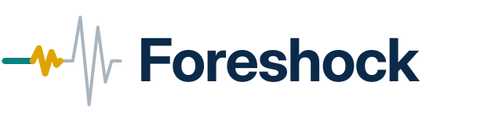
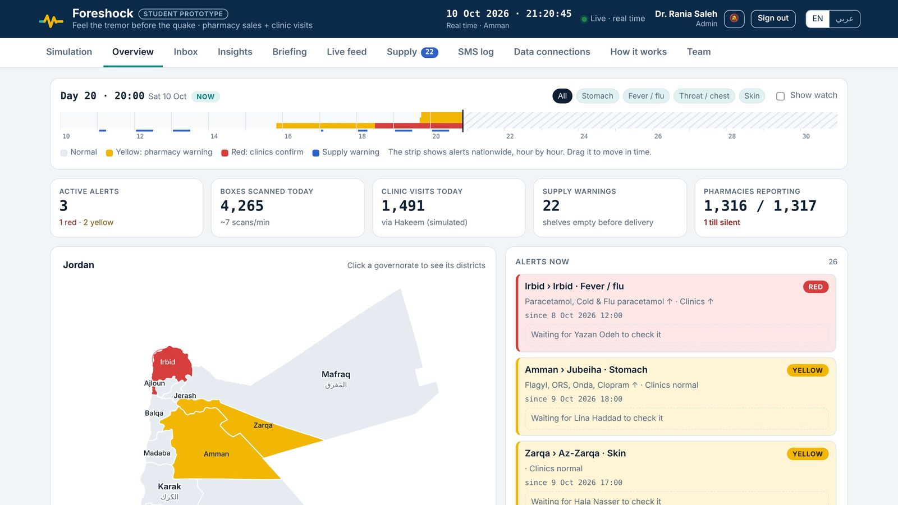
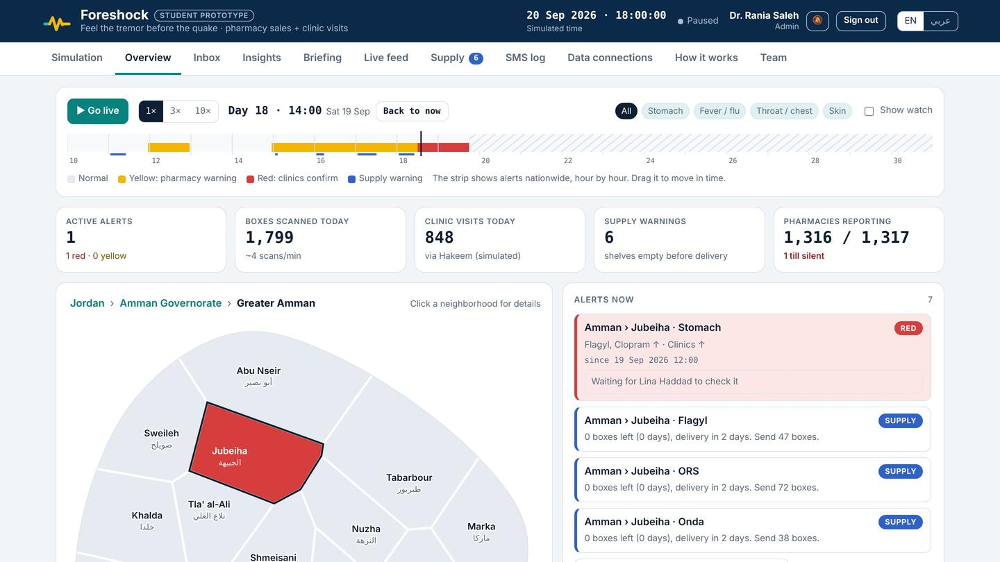
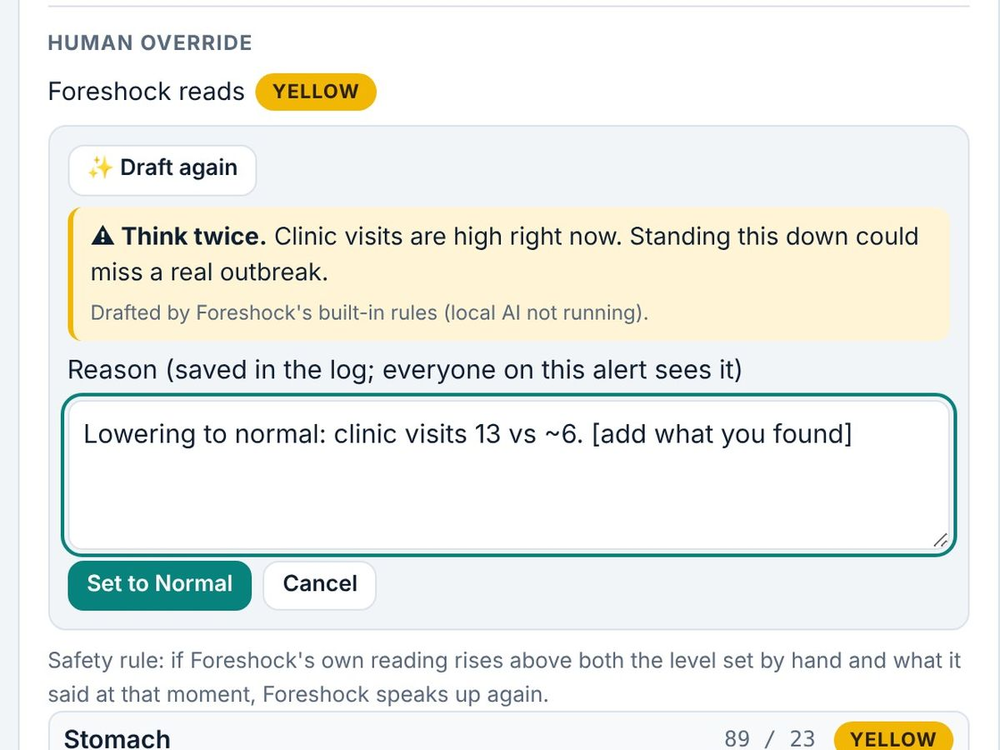

<p align="center"></p>

<p align="center"><b>Feel the tremor before the quake.</b><br>
An outbreak early-warning system for Jordan that watches pharmacy sales and clinic visits.</p>

<p align="center">Sydney Innovation Challenge 2026 · SDG 3: Good Health and Well-being · by Yousef Al Kattan</p>

> **Student prototype.** All pharmacy, clinic, alert and SMS data is simulated. The accounts are demo accounts. Foreshock is not affiliated with or endorsed by Jordan's Ministry of Health, the JFDA or Hakeem.



## Why

When people get sick, most go to the pharmacy first: Panadol for a fever, rehydration salts for a stomach bug, and in Jordan often antibiotics without seeing a doctor. Clinics see them a couple of days later and hospitals later still. By the time hospitals notice an outbreak, it has been spreading for days. Jordan has about 4,500 pharmacies, roughly one for every 2,500 people.

## How it works

1. **Learn normal.** Every one of 64 areas gets its own baseline that knows quiet Fridays, paydays, heatwaves, Ramadan and Eid.
2. **Yellow.** When several medicines for the same illness jump together in one area, the area's inspector is told to check.
3. **Red.** When clinic visits for that illness rise too, the alert turns red. The inspector visits, fills in a checklist with photos and confirms it to the Ministry.

Safety rules: an admin approves before any SMS goes to residents (Arabic and English); every manual override needs a reason saved in the log; an AI drafts that reason and gives a second opinion; and if an area set to normal by hand keeps getting worse, Foreshock speaks up again.



## The fair test (simulated)

100 simulated outbreaks, Foreshock against **EARS C2**, the CDC early-warning method. At the same false-alarm rate (about one per simulated world):

| | Outbreaks caught (of 100) | False alarms per world |
|---|---|---|
| **Foreshock** | **61** | 0.9 |
| EARS C2 (z > 8) | 28 | 1.0 |

EARS only catches more by making many more false alarms (81 caught at 118.6 false alarms per world). Re-run it with `python3 server/evaluate.py`. Full method in [`server/evaluation.json`](server/evaluation.json).

## What's inside

- A Python server with an API, a SQLite database, accounts and roles (no packages needed to run it)
- A simulator that pretends to be **1,317 pharmacy tills** (each with its own key) and Hakeem clinic visits
- A web dashboard that installs on phones, with an inspector view, an inbox, an SMS log, live feed and supply warnings
- **Foreshock's own AI**: a risk model (logistic regression) trained on 100 simulated outbreaks that predicts which areas could turn yellow or red in the next 48 hours
- Optional local AI through [Ollama](https://ollama.com) (no API key, no internet once downloaded) for override drafts, the weekly briefing and "Ask Foreshock"
- An antibiotic misuse map, silent-till detection and a one-click weekly briefing



## Run it

You need Python 3.8 or newer. Nothing else to install.

```bash
python3 server/server.py
```

Your browser opens Foreshock. Every demo account uses the password `foreshock`. Try `admin` (Ministry admin) and `inspector.amman` (inspector).

On a Mac or Windows you can also double-click `Start Foreshock (Mac).command` or `Start Foreshock (Windows).bat`. [`README.txt`](README.txt) has the full guide: the 2-minute demo, overrides, the AI and every option.

## Put it online

- **Always on:** this repo has a `Dockerfile` and `render.yaml`. On [render.com](https://render.com): New → Blueprint → pick this repository. On a public link, safe mode is on: accounts, passwords, settings and the world can't be changed.
- **Quick link from a laptop:** install `cloudflared`, then run `python3 server/server.py --share`.

## Privacy

Foreshock only collects counts: how many boxes of each medicine were sold, per area, per hour. **No names, no prescriptions, no prices.** It fits what Jordan already has: medicine boxes carry GS1 barcodes required by the JFDA, and public clinics record visits in Hakeem.

## Credits

Built by Yousef Al Kattan, Jordan. Map borders: [geoBoundaries](https://www.geoboundaries.org) (CC BY 4.0). Weather: [Open-Meteo](https://open-meteo.com).
